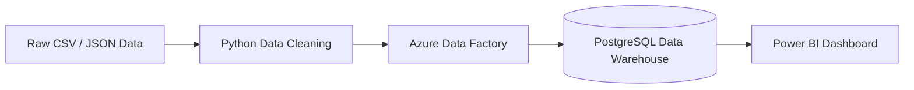

# ShopSphere — E-Commerce Data Engineering & KPI Analytics

ShopSphere is an end-to-end e-commerce analytics project that transforms raw operational data into clean datasets, loads them into a relational data warehouse, and delivers business insights through KPI reporting and dashboards.

## Project Overview

The project brings together data from multiple e-commerce entities—including customers, orders, order items, products, suppliers, payments, and returns—to support consistent reporting and business analysis.

### Data Pipeline

## Tools & Technologies

- **Python (Pandas):** data profiling, cleaning, standardization, and preparation
- **Azure Data Factory:** cloud-based data movement and pipeline orchestration
- **PostgreSQL:** relational storage and analytical SQL queries
- **Power BI:** interactive business intelligence dashboards
- **SQL:** aggregations, joins, window functions, and KPI calculations
- **HTML:** standalone KPI dashboard deliverable

## Data Sources

The project includes raw and cleaned datasets for:

- Customers
- Orders
- Order items
- Products
- Suppliers
- Payments
- Returns

The data-cleaning workflow is located in `data cleaning/`, with source files in `data cleaning/data/input_data/` and cleaned outputs in `data cleaning/data/output_data/`.

## Data Warehouse Design

The analytical model uses a star-schema approach centered on `fact_order_items`, with dimension tables for customer, product, supplier, and date.

- **Fact table:** `fact_order_items`
- **Dimensions:** `dim_customer`, `dim_product`, `dim_supplier`, `dim_date`
- **Measures:** quantity, unit price, discount percentage, and line total
- **Keys:** surrogate primary keys in dimensions and foreign keys in the fact table

See `Star Schema Data Warehouse Diagram.png` for the schema visualization.

## KPI Deliverables

The analysis is designed to produce all eight requested KPI outputs:

1. **Net Revenue by Product Category, per Month** — revenue after discounts and approved refunds.
2. **Top 10 Customers by Net Lifetime Value** — completed-order value net of returns.
3. **Standardized Customer Segment Profile** — customer counts and average order value by cleaned segment.
4. **Month-over-Month Order Volume & Revenue Growth, by Channel** — monthly change in order count and net revenue for each channel.
5. **Product Return Rate — Top 10 and Bottom 10** — return rate by product, subject to a minimum order-volume threshold.
6. **Supplier Performance Scorecard** — supplier revenue, return performance, and quality-rating comparison.
7. **Customer Repeat-Purchase Rate** — share of eligible customers placing another completed order within 90 days of their first completed order.
8. **Payment Reconciliation & Anomaly Report** — differences between recorded payments and calculated order totals, including missing or ambiguous records.

The standalone dashboard is available. Review the calculation assumptions and source-data quality issues before interpreting results as final business figures.

## Data Quality & Assumptions

Business metrics depend on data quality and clearly defined rules. The KPI calculations should document how they handle duplicate records, inconsistent labels, orphaned customer/product/supplier references, cancelled orders, refunds, missing payments, and ambiguous channel values. Supplier scoring weights and reconciliation tolerances are analytical assumptions and should be disclosed rather than presented as universally defined standards.

## Project Outcome

ShopSphere demonstrates a practical analytics workflow—from source-data cleaning and cloud pipeline design to relational data modeling, SQL-based KPI computation, and dashboard reporting. It is intended as a portfolio/hackathon project and should be described according to the components actually implemented and tested.

